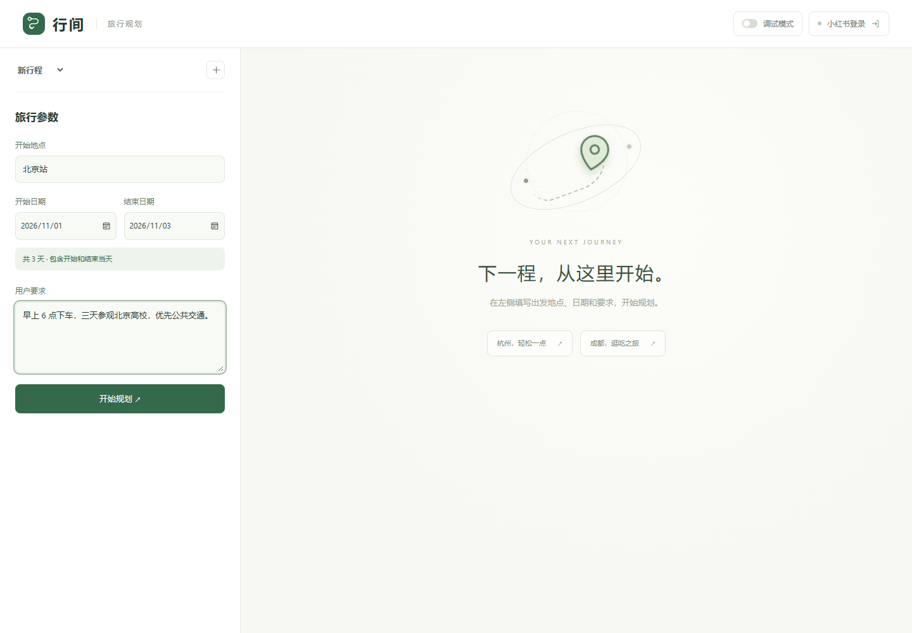
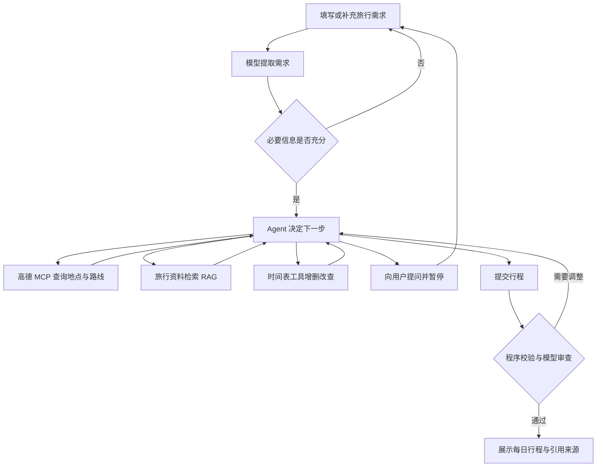

# 行间 · Agent 旅行规划

基于 Django、LangChain、DeepSeek、高德 MCP 和本地 RAG 的旅行规划网页。用户填写出发地点、日期与要求，Agent 按需查询路线和攻略，将安排写入时间表，由程序检查时间冲突，再生成每日行程。



[项目流程与结构](docs/ARCHITECTURE.md) · [全部提示词](PROMPTS.md) · [部署说明](deploy/README.md)

## 功能

- 表单输入开始地点、开始日期、结束日期、用户要求；支持继续对话补充信息、修改行程。
- Agent 采用 ReAct 思路的工具调用循环：选择工具 → 执行 → 读取结果 → 决定下一步。
- 高德 MCP 查询地点、交通路线、沿途酒店与餐馆；小红书补充游览、体验和评价等攻略。
- RAG 先查近期资料，不足时扩大时间范围；仍不足则补采、入库、重新检索。
- 时间表通过工具增删改查，Python 检查时间重叠、交通间隔、日期顺序及旅行日期范围。
- 保留会话、攻略、时间表草稿与最终行程；可选调试模式记录执行阶段、工具调用和错误。

## 规划流程



工具选择由模型根据当前信息决定，不要求每轮都爬取资料。RAG 检索与时间冲突判定由程序执行；模型负责判断检索证据是否回答问题、选择下一步动作以及检查行程是否符合用户需求。

## 技术栈

| 层次 | 实现 |
| --- | --- |
| 网页 | Django Templates、原生 JavaScript、CSS，支持手机布局 |
| 服务端 | Django 5.2，后台线程池执行任务，网页轮询进度 |
| Agent | LangChain 消息与工具接口、DeepSeek、Pydantic 结构化输出 |
| 地图 | langchain-mcp-adapters 接入高德 MCP |
| 检索 | FastEmbed、中文 BGE 向量模型、NumPy 余弦相似度 |
| 数据 | SQLite 保存会话、笔记、分块向量、采集记录及时间表 |
| 采集 | Playwright，使用正常浏览器登录状态读取小红书笔记 |
| 部署 | Nginx、Gunicorn、Supervisor |

检索时先按发布时间和城市筛选资料，再计算向量相似度，返回相关片段及其来源。

## 本地运行

本地验证环境为 Windows / Python 3.12。依赖版本见 [requirements.txt](requirements.txt)。

```powershell
# 在项目目录中执行
python -m venv .venv
.\.venv\Scripts\python.exe -m pip install -r requirements.txt
.\.venv\Scripts\python.exe -m playwright install chromium
Copy-Item .env.example .env
```

编辑本地 `.env`：

| 变量 | 用途 |
| --- | --- |
| `DJANGO_SECRET_KEY` | 自行生成的 Django 随机密钥，替换示例占位内容 |
| `DEEPSEEK_API_KEY` | DeepSeek API Key，仅保存在后端 |
| `DEEPSEEK_MODEL` | 默认 `deepseek-flash`，按实际账号可用模型配置 |
| `AMAP_API_KEY` | 高德 MCP 所需 Key |
| `DJANGO_ALLOWED_HOSTS` | 本地默认 `127.0.0.1,localhost,testserver`；部署时设置实际域名或 IP |

生成 Django 随机密钥：

```powershell
.\.venv\Scripts\python.exe -c "from django.core.management.utils import get_random_secret_key; print(get_random_secret_key())"
```

配置完成后：

```powershell
.\.venv\Scripts\python.exe manage.py migrate
.\.venv\Scripts\python.exe manage.py runserver 127.0.0.1:8017 --noreload
```

访问 <http://127.0.0.1:8017/>。也可以使用 `start.ps1` 安装依赖、迁移数据库并启动。PyCharm 应选择项目内 `.venv\Scripts\python.exe` 作为解释器。

第一次使用小红书资料时，点击页面右上角“小红书登录”，在弹出的浏览器完成登录。首次向量化会下载约 90 MB 的模型。模型、高德请求需要对应服务可用。

Linux / macOS 使用 `.venv/bin/python`，并通过 `cp .env.example .env` 创建配置。Linux 浏览器所需系统依赖可用 `python -m playwright install --with-deps chromium` 安装。

## 项目结构

```text
config/                      Django 配置和路由
planner/
  forms.py                   旅行表单及日期范围校验
  views.py                   会话、任务进度、调试、小红书登录 API
  jobs.py                    后台执行和草稿持久化
  models.py                  会话、消息、任务、笔记、向量分块、采集记录
  schemas.py                 模型输出和工具参数结构
  services/
    agent.py                 需求提取、工具调用循环、提交与审查
    llm.py                   DeepSeek 调用、结构化输出与错误处理
    knowledge.py             分块、向量化、时间分层检索和按需补采
    crawler.py               小红书浏览器采集与发布时间解析
    schedule.py              时间表 CRUD 和程序冲突检查
    debug.py                 可选调试日志及脱敏
  migrations/                数据库迁移
  tests.py, test_*.py         自动化测试
templates/planner/           网页模板
static/planner/              样式和前端交互
scripts/                     工具、诊断、提示词导出和发布检查
deploy/                      服务器部署配置
docs/                        架构说明和界面示例
```

## 检查与调试

```powershell
# 本地测试：模拟外部服务，不需要真实模型或高德请求
.\.venv\Scripts\python.exe manage.py check
.\.venv\Scripts\python.exe manage.py test planner

# 真实服务连通检查：会调用已配置的服务
.\.venv\Scripts\python.exe manage.py check_services

# 导出提示词：会连接高德读取工具定义
.\.venv\Scripts\python.exe scripts/export_prompts.py

# 提交前检查 Git 暂存区是否包含敏感文件或已知密钥
.\.venv\Scripts\python.exe scripts/check_secrets.py
```

自动化测试覆盖会话隔离、输入验证、RAG 时间过滤、采集冷却、调试脱敏、时间表冲突与持久化、工具结果反馈等。

调试模式默认关闭。开启后记录模型输入/输出、工具参数与结果、检索窗口、补采过程、耗时和异常，文件位于 `.runtime/debug/`，页面可下载 JSONL。日志会脱敏密钥和认证信息，不记录模型内部思考内容。调试日志仍可能包含用户需求和旅行信息，因此不上传仓库。

## 密钥和本地数据

仓库只提供 `.env.example` 空配置模板。以下内容被 `.gitignore` 排除：

- `.env` 及其他本地环境配置；仅 `.env.example` 可提交。
- `.runtime/`：小红书 Cookie、登录状态、调试日志、模型缓存和部署私有压缩包。
- SQLite 数据库：会话、用户需求、抓取笔记、向量与时间表。
- `.venv/`、IDE 配置、私钥文件和压缩包。

发布前除了检查忽略规则，还应扫描暂存区和 Git 历史；`.gitignore` 不会自动删除已经提交的敏感文件。发现密钥曾被提交时，应先在服务平台撤销并更换密钥，再清理历史。

## 使用说明

- 高德可检索酒店、餐馆及地点详情；评分、消费、营业时间等字段以实际返回为准，不保证实时房价、空房或预订信息。
- 发布时间不等于实际游览时间，也不保证内容今天仍有效；未知日期明确标记。
- 小红书采集依赖登录状态和页面结构，遇到登录或验证会暂停；图片中的攻略暂未做 OCR。
- 有笔记 ID 和内容哈希的入库去重，但采集冷却仅针对相同查询与城市，换一种问法仍可能重复抓取。
- 程序检查基于已填入的交通耗时和活动时间，不代表所有现实条件均已验证。
- 后台任务使用进程内线程池，重启会中断运行中的任务；已有数据保留，可重新提交需求继续规划。
