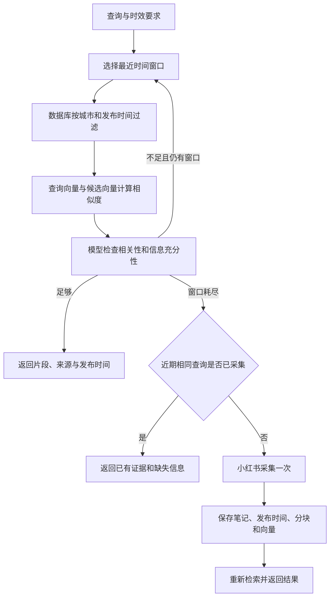

# 项目流程与代码结构

## 1. 从表单到后台任务

用户填写开始地点、开始日期、结束日期和用户要求。`TripInputForm` 检查字段长度、日期有效性和起止顺序，API 将表单保存在 `Conversation.trip_input`，并将本次输入保存为 `Message`。

`views.chat` 在数据库事务提交后调度 `jobs.enqueue`，由线程池执行任务。网页轮询任务接口展示进度；不让浏览器等待一次长 HTTP 请求完成全部规划。

起点和日期以结构化表单为准，独立于模型提取的 `requirements`。分析、规划和审查阶段都会收到表单，避免模型提取时丢失这些信息。更新起点或日期需要修改表单。

## 2. Agent 循环

入口是 [`planner/services/agent.py`](../planner/services/agent.py) 的 `plan_trip`。

1. 通过结构化输出提取需求。如果缺少影响规划的必要信息，返回问题并暂停。
2. 动态发现高德 MCP 工具，与本地工具一起绑定到模型。
3. 模型根据当前上下文选择工具，程序执行后将结果作为 `ToolMessage` 放回上下文。
4. 模型读取结果，再选择查询、时间表操作、补问或提交。
5. 提交后，程序和模型分别检查，发现问题则将反馈放回循环进行修改。

工具编排采用 ReAct 思路，使用显式 Python 循环和 LangChain 消息接口。网页展示执行阶段和工具行动。

| 工具 | 作用 | 返回后如何继续 |
| --- | --- | --- |
| `get_travel_info` | 检索本地资料，必要时补采小红书 | 返回片段、来源、发布时间及缺失信息 |
| 高德 MCP 工具 | 查询地点、周边、详情、路线等 | 返回实际地点和交通信息供模型选择 |
| `manage_schedule` | 时间表 list/add/update/delete/check，支持批量操作 | 返回活动 ID、当前表格及程序检查问题 |
| `ask_user` | 请求用户补充 | 暂停本轮，等待下一条输入 |
| `submit_plan` | 提交标题、摘要、预算等概述 | 每日活动由程序从时间表读取，不使用模型另写的一套活动 |

同一轮中相同高德请求有内存缓存。默认最多 20 轮 Agent 调用，审查失败后最多 2 次修订；达到上限后返回可继续补充的状态。需求和已保存的时间表草稿会保留。

## 3. 高德与小红书的分工

高德通过 `maps_text_search` 搜索候选地点，`maps_around_search` 查询路线节点附近的酒店、餐馆，`maps_search_detail` 补充 POI 坐标和实际可用详情，再调用路线工具获取交通信息。

小红书用于补充游览顺序、建议停留时间、住宿体验或餐饮评价等攻略。模型按需要决定是否检索，不强制每个地点都采集一次。高德返回字段不足时也不直接补造信息，而是继续查资料或向用户提问。

高德地点查询不等于酒店预订接口；`rating`、`cost`、营业时间等字段并不保证所有 POI 都有，更不保证实时房价或空房。

## 4. RAG：先近期，后历史，再补采

实现在 [`planner/services/knowledge.py`](../planner/services/knowledge.py)。

### 入库

- Playwright 通过可见“最新”控件排序并滚动，最多收集 200 个唯一候选；按笔记 ID 去重，排除图文，跳过刷新周期内的合格记录。
- 依次从详情响应、初始状态、绑定当前 ID 的页面日期核实发布时间，正文已成功仍会补读日期。日期失败会重试、记录原因并跳过，不作为有效笔记保存。
- 已读取正文与元数据缓存在本轮内。程序按核实日期降序处理，每批最多 5 篇由模型判断知识库价值；模型不按当前问题排除有旅行价值的资料，不补写日期或正文。
- 必填字段与质量判断双重通过才入库，目标是实际新增 30 篇；重复、失败、排除、质量拒绝不计入新增。城市、地点和主题从正文提取，不使用查询城市兜底。
- 按约 420 字切块，长段切分使用 60 字重叠；将“标题 + 分块正文”交给 FastEmbed / 中文 BGE 模型向量化。
- `Note` 保存笔记，`Chunk` 保存片段、向量和模型名。笔记 ID 唯一；正文未变且已有对应模型向量时，跳过重复向量化，允许修正已核实元数据。

### 检索

默认依次搜索近 30 天、30～90 天、90～365 天。参数 `freshness_days` 可缩短或扩展范围；允许历史回退时，最后查询更早的已核实资料。时间与城市过滤在向量候选选择之前执行。未核实日期或未通过入库质量判断的旧记录保留，但暂不参与检索。

使用 NumPy 计算余弦相似度，阈值为 0.40；候选取分数较高的片段，每篇笔记最多 2 块，总结果最多 10 块，返回前按发布时间从新到旧排序。

模型检查的对象是检索片段，回答“哪些片段有用、是否足够、还缺什么”。它不负责执行数据库检索。不同窗口的有用证据可以互相补充，不额外要求官方或权威来源。

不足时，每次 `get_travel_info` 最多触发一轮有候选、访问、重试和时间预算的补采。相同查询与城市保留 10 分钟冷却，但登录失败不阻止完成登录后立即继续。返回 `crawl_report` 概要供 Agent 判断后续查询方向，逐篇明细保存在 `CrawlLog.report`。

日期解析依据、失败类别、配置和模拟测试说明见 [小红书采集架构](xhs-collection.md)。

## 5. 程序拥有时间表

[`planner/services/schedule.py`](../planner/services/schedule.py) 中的 `Timetable` 管理活动 ID、排序与一致性，模型只通过工具提交数据。

| 校验 | 示例 |
| --- | --- |
| 时间格式与顺序 | 结束时间必须晚于开始时间，`24:00` 只能表示结束 |
| 活动重叠 | 09:00～11:00 与 10:00～10:30 会报告重叠 |
| 交通间隔 | 上一活动 10:00 结束，下一活动 10:10 开始，交通耗时 20 分钟则报错 |
| 独立交通时段 | 20 分钟的交通不能放进 10 分钟时段 |
| 日期一致性 | 同一天不重复，日期应与第几天对应 |
| 表单范围 | 根据开始日期计算每天日期，超出结束日期的新增或移动会被拒绝 |

结构非法的批量编辑整体回滚；结构合法但存在时间冲突的草稿可以暂存，供 Agent 继续修订。`submit_plan` 会阻止有冲突或空白的时间表提交。最后的模型审查检查用户需求与地点信息，不替代程序的时间计算。

## 6. 数据结构与恢复

| 模型 | 主要用途 |
| --- | --- |
| `Conversation` | 会话所有者、结构化表单、提取需求、时间表草稿、最终行程 |
| `Message` | 用户与助手消息 |
| `Run` | 每次任务的运行状态、执行事件、调试开关和错误 |
| `Note` | 笔记正文、类型、发布时间及解析依据、质量结果、城市/地点/主题、内容哈希 |
| `Chunk` | 笔记片段、向量、向量模型名 |
| `CrawlLog` | 查询、城市、实际新增数、核实范围和逐篇结果报告，用于诊断与冷却 |

会话和任务按 Django session 隔离。每次成功修改时间表都会保存，等待补充信息时也保留草稿。进程内运行任务不具备宕机续跑能力；`recover_runs` 将中断任务标记为可重试，用户再次提交后继续规划。

## 7. 调试与测试

调试日志覆盖模型请求、工具调用、检索窗口、向量入库、审查结果与耗时，使用 JSONL 保存，默认关闭并进行密钥脱敏。日志可能包含用户数据，不作为公开示例发布。

自动化测试通过模拟外部服务验证输入校验、会话隔离、RAG 检索、时间表管理与工具协议。运行 `python manage.py test planner` 执行测试；使用 `python manage.py check_services` 检查已配置的真实服务连通性。
